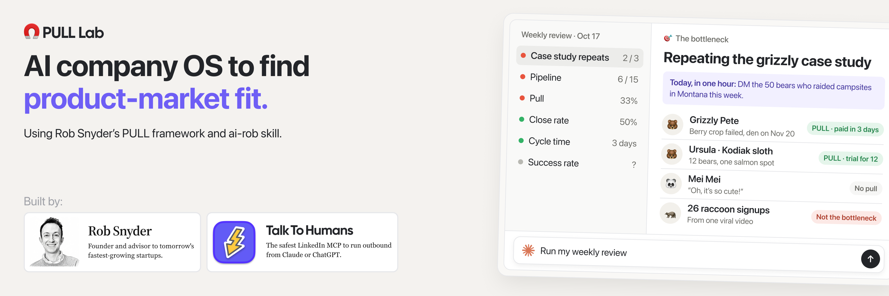
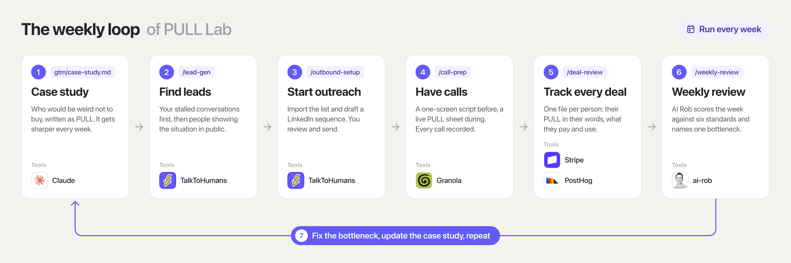
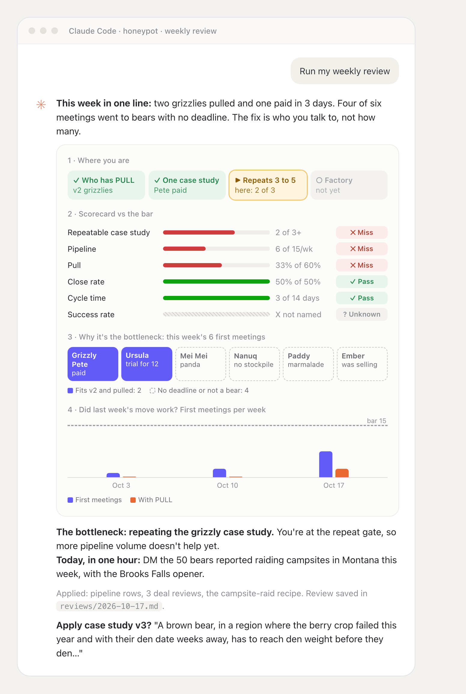
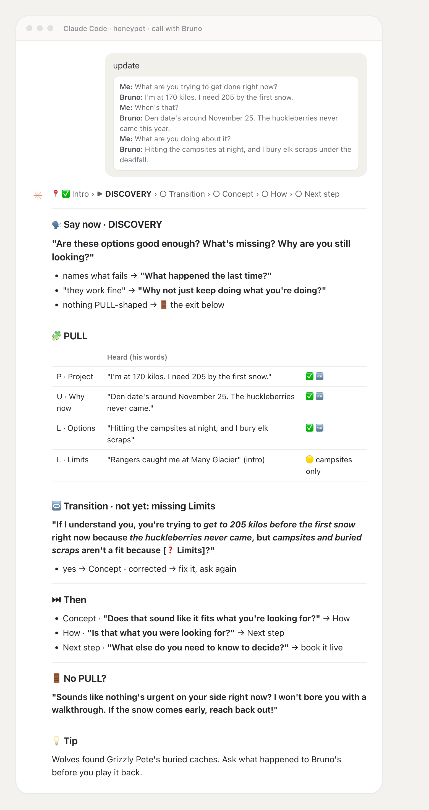

<a href="https://www.talktohumans.app/?utm_source=github&utm_medium=readme&utm_campaign=pull-lab"></a>

# PULL Lab

Pre-PMF, you know the pain cave: lots of "wow, this is amazing", nobody buys, so you build another feature.

But you don't need a GTM strategy. You need ONE customer who actually wants to buy, then another one just like them.

PULL Lab is an AI company OS that runs that loop with you, every week, using Rob Snyder's PULL framework and ai-rob skill:

- **You find who would be weird NOT to buy.** Your case study gets sharper every week, in your buyers' own words.

- **Your learning compounds.** Every week starts from what the last one proved.

Built with [Rob Snyder](https://robsnyder.org/) and [TalkToHumans](https://www.talktohumans.app/?utm_source=github&utm_medium=readme&utm_campaign=pull-lab).

**Want to see it before you set it up?**

Read [the sample week](examples/honeypot/reviews/2026-10-17.md): a startup selling to bears, where the review catches a signup spike made of raccoons.

## How it works

### The weekly loop



1. **Case study.** The one situation you're trying to serve, written as PULL in `gtm/case-study.md`. It starts as a guess and gets sharper every week.
2. **Leads.** `/lead-gen` turns the case study into public signals and finds people showing them recently, warmest first: your own stalled conversations, then people engaging with your content, then people posting about the situation, then cold.
3. **Outreach.** `/outbound-setup` imports the list and drafts a short sequence. You review and send every message.
4. **Calls.** `/call-prep` builds a one-screen call script with AI Rob, updates it live as you paste the transcript, and debriefs.
5. **Memory.** `/deal-review` keeps one file per person in `deals/`: context, PULL, what they pay and use, a timeline, and AI Rob's dated deal reviews. Every call is also logged in `gtm/sales.md`.
6. **Review.** `/weekly-review`, every Friday: outreach, calls, deals, activation and revenue go to AI Rob, which scores the week and names the one bottleneck.
7. **Iterate.** Fix the bottleneck, update the case study, repeat.

### What it looks like

<table>
  <tr>
    <td width="50%" valign="top"></td>
    <td width="50%" valign="top"></td>
  </tr>
  <tr>
    <td align="center"><em>Weekly review, in chat</em></td>
    <td align="center"><em>Call-prep, mid-call</em></td>
  </tr>
</table>

### What you need

| Slot | Why | Required? | What I use | Also works |
|---|---|---|---|---|
| **Agent** | Runs the skills, reads your tools and keeps the files up to date | Yes | [Claude Code](https://claude.com/claude-code) or Claude Cowork | Codex, Cursor (they read `AGENTS.md`) |
| **PULL brain** | Judges every call and every week against the PULL framework: is there a real Project, can it wait, which options fail and why | Yes | [AI Rob](https://airobsnyder.com), delivered through the Skillfully MCP | — |
| **Lead sourcing** | Your own stalled conversations first, then people showing your case study's situation in public, right now: who engages with your posts, who posts about the situation and who comments on it, then cold leads by company and role | Optional | [TalkToHumans](https://www.talktohumans.app/?utm_source=pull-lab&utm_medium=github&utm_campaign=readme) MCP | Any web search or scraping tool |
| **LinkedIn outreach** | Import leads with the signals that found them, draft sequences, and see who accepted, replied and booked, per outreach angle | Optional | [TalkToHumans](https://www.talktohumans.app/?utm_source=pull-lab&utm_medium=github&utm_campaign=readme) MCP | A CSV and sending by hand |
| **Call recording** | Keep buyers' exact words. They're the evidence, and your memory of a call isn't | Optional | Granola MCP | Fathom, Fireflies, any transcript you paste |
| **Billing** | See who actually paid, trialed or churned. Only a purchase proves the case study | Optional | Stripe MCP | Paste your numbers |
| **Product analytics** | Understand signups, activation and retention, and what's actively used or not | Optional | PostHog MCP | Mixpanel MCP |

*Every skill runs without the optional tools. It asks you for what it can't fetch and says so in the review.*

### What's inside

```
pull-lab/
├── AGENTS.md              # instructions for your agent (CLAUDE.md imports it)
├── context/               # company, founders, product: read before every task
├── gtm/                   # AI Rob's memory: case study, pipeline, sales log, sales process, post-sales
├── deals/                 # one file per person: context, PULL, account, timeline, AI Rob's reviews
├── evidence/              # public signals (posts, reviews, job ads) per buyer situation
├── outbound/              # signals and sourcing recipes
├── reviews/               # one weekly review per Friday
├── assets/                # README images
├── .claude/skills/        # weekly-review, call-prep, deal-review, lead-gen, outbound-setup
└── examples/honeypot/     # a complete sample week for a fictional startup. Delete when ready.
```

## Get started

### Set up (once)

1. **Fork it, privately.** Click **Use this template** → **Create a new repository** → **Private**.\
   *(A regular fork of a public repo stays public, and your copy will hold your customers' words.)*
2. **Clone it locally.**
   ```bash
   git clone git@github.com:<you>/pull-lab.git
   ```
3. **Open the folder as a project** in Claude Code or Claude Cowork (or Codex, if that's what you use). In agents without slash commands, ask in plain words (*"find leads"*): `AGENTS.md` points them to each skill.
4. **Connect the tools.** AI Rob first ([airobsnyder.com](https://airobsnyder.com)), then the MCPs from [What you need](#what-you-need) that you don't have yet.
5. **Fill in `context/`.** Ask your agent: *"Help me fill in context/"*. It will ask what you sell, your stage and your one goal with a date.
6. **Run a first weekly review.** Say *"run my weekly review"*. AI Rob sets up its memory in `gtm/` and `deals/`, loads what your tools already know (past calls, customers, signups, revenue), helps you write the first version of your case study, and names where to start. Want to see a finished week first? Say *"Run /weekly-review on examples/honeypot as a demo."*

### Then, every week

7. **Find leads.** *"Find leads"* (`/lead-gen`).
8. **Start outreach.** *"Launch outreach for this list"* (`/outbound-setup`). You review and send.
9. **Have calls, and record them.**
   - **Before:** *"Prep my call with Jane"* (`/call-prep`) gives you a one-screen script.
   - **During:** put your call on the left and the chat on the right. Every few minutes, paste the transcript so far (Granola lets you copy it mid-call), or just say *"update"*. The screen tells you what to say next.
   - **After:** *"call's over"*, then *"review this call"* (`/deal-review`). Do the same after every reply or email.
10. **Next Friday, run the weekly review.** It updates your pipeline, deals and playbook itself, and asks before changing the case study. Iterate on the bottleneck it names.
11. **Find product-market fit,** after many iterations.

## Make it yours

The choices behind this repo, and how to change them.

Every skill is a plain markdown file in `.claude/skills/`: edit it yourself, or ask your agent to.

- **LinkedIn for outreach.** Nothing to set up (no domains, warm-up or deliverability to manage), you already have an account and a network to start from, and 20 to 30% of accepted connections replying is reachable once the opener is tuned. Cold email works too, it's just more to run before you've found PULL. To switch, edit `/outbound-setup` to draft for your email tool.
- **One case study at a time.** Growth comes from repeating one situation, not serving many. To test a second one, run it as a separate sprint (`/lead-gen` asks).
- **Only a purchase proves the case study.** On a call, a buyer pulls when they start the next step themselves, like asking the price. A trial you offered, signups and compliments don't count. This is the core of the method, so keep it.
- **AI Rob makes every PULL judgment.** The skills gather and file the evidence, AI Rob scores it. Without it, they stop instead of guessing.
- **Folder and file names.** `deals/`, `gtm/`, `reviews/` and the rest are just names. If you prefer different terms, ask your agent to rename them and update every link and skill that points to them.
